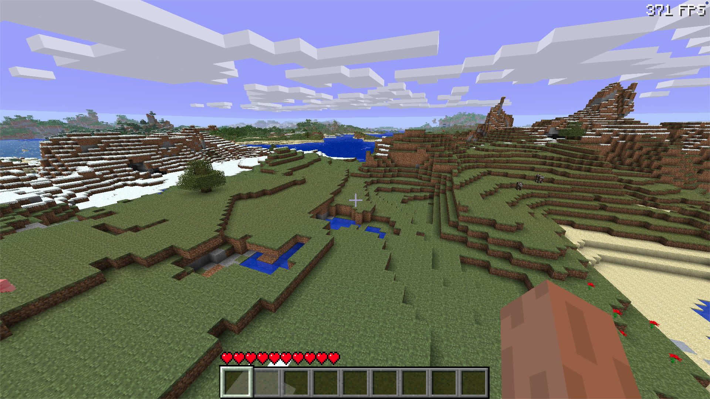
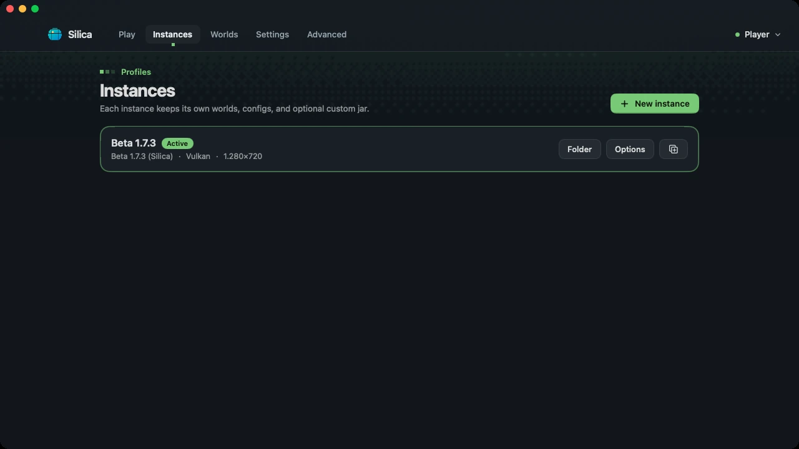
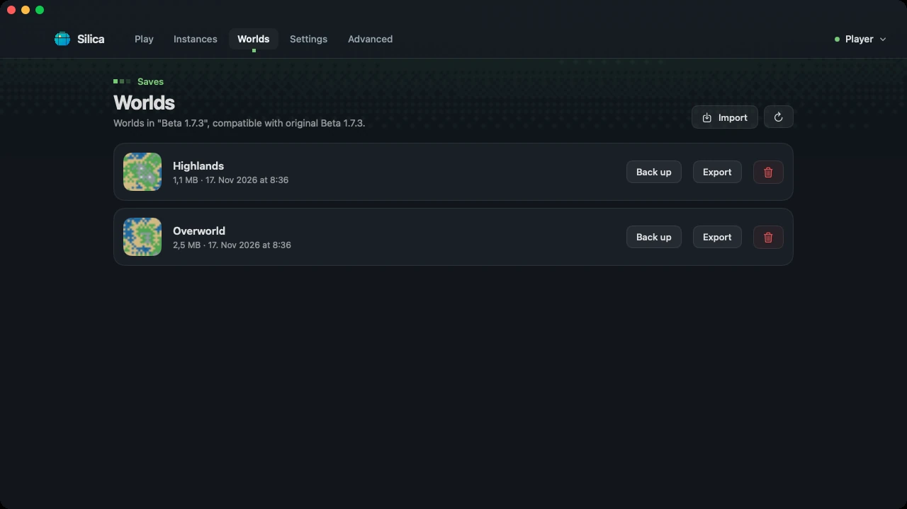
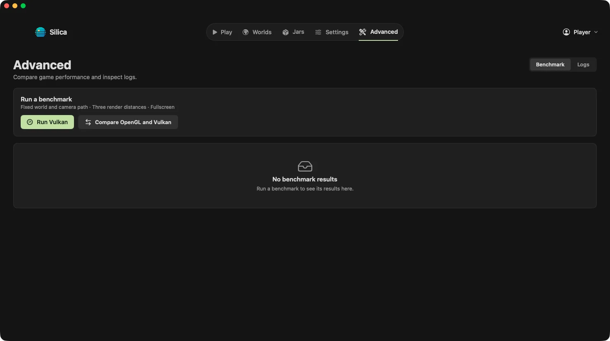

<p align="center">
  
</p>

<p align="center">
  <b>The Minecraft Beta launcher and native Vulkan engine, built for Apple Silicon.</b><br>
  Beta 1.7.3 natively without Rosetta — Vulkan 1.2 rendering, true-textured distant LODs, Better Grass, and isolated instances.
</p>

<p align="center">
  <a href="https://silicalauncher.xyz"><b>silicalauncher.xyz</b></a>
  &nbsp;·&nbsp;
  <a href="https://silicalauncher.xyz/roadmap">Roadmap</a>
  &nbsp;·&nbsp;
  <a href="https://silicalauncher.xyz/docs">Docs</a>
  &nbsp;·&nbsp;
  <a href="docs/DEVELOPMENT.md">Developing</a>
  &nbsp;·&nbsp;
  <a href="CHANGELOG.md">Changelog</a>
  &nbsp;·&nbsp;
  <a href="https://silicalauncher.xyz/privacy">Privacy</a>
</p>

<p align="center">
  <a href="https://github.com/undrwtrsprite/silica/releases/latest"></a>
  
  
  
  
  
</p>

<br>

<p align="center">
  
</p>

## What it is

Silica runs Minecraft Beta 1.7.3 natively on Apple Silicon on top of an `arm64` Java 21 runtime, LWJGL 3 (`GLFW` + `OpenAL Soft`), and a Vulkan 1.2 renderer over MoltenVK. Your saves stay 100% compatible with vanilla Beta 1.7.3 and servers, while a native SwiftUI launcher handles setup, Microsoft sign-in, isolated instances, worlds, settings, updates, and benchmarks.

> **This repository contains no Mojang code, jars, or assets.** You need to own Minecraft: Java Edition. On first launch, Silica downloads the clean Beta 1.7.3 client from Mojang's servers (or verifies a copy you already have against Mojang's SHA-1 checksum), prepares it locally on your Mac, and applies Silica's hooks at launch without modifying your original jar.

## How it's made

Silica is a passion project, openly AI-assisted and licensed under GPL-3.0. Every Vulkan shader, chunk worker, LOD mesher, launcher screen, and benchmark harness lives in this repo so anyone can inspect or reproduce the numbers.

## Performance

Same world, camera path, and seed (`1337`) on both renderers. Measured on an Apple M5 (`1080p` fullscreen, 5 s warm-up then 10 s measured; 3 s/4 s at 32 chunks; 8 s/8 s with LODs at `12+64` chunks, 17 Nov 2026):

| Render distance | OpenGL | Vulkan |
|---|---:|---:|
| Far · 256 blocks | 121 FPS | **1129 FPS** |
| Normal · 128 blocks | 247 FPS | **1836 FPS** |
| Short · 64 blocks | 482 FPS | **2809 FPS** |
| Extreme · 32 chunks | — | **600 FPS** |
| Real-block LOD · 76 chunks (`12+64`) | — | **437 FPS** |

On Far (`256` blocks), Vulkan runs at **9.3×** the frame rate (`2.6 ms` 99th-percentile frame vs `14.8 ms` on OpenGL). Title screen loads in ~1.5 s vs ~3.2 s under Rosetta. Extended sustained runs settle lower as the chip warms up.

## What's in Silica (`v0.2.1`)

<p align="center">
  
</p>

- **True-textured tiled LODs & `.lod` cache:** A 5-tier real-block quadtree (`1×1×1` down to `16×4×16`) extends visibility up to `+128` chunks past Render Distance with hardware-tiled Vulkan terrain atlas shaders (`1:1` crisp block textures, zero stretching), cross-chunk border tree canopies, day/night emissive lighting, and persistent per-world region caches under `saves/<world>/lod/`.
- **Better Grass (`Off`, `Fast`, `Fancy`):** Classic Better Grass toggle in Video Settings, extending full grass shading down side faces across both live chunks and distant LOD slopes.
- **Render distance `2–32` chunks:** Smooth chunk slider replacing Beta's 4-preset toggle (`F` cycles `{2, 4, 8, 12, 16, 20, 24, 32}`).
- **Faster terrain & culling:** Multithreaded chunk generation and meshing, hoisted Perlin noise, direct-chunk lighting, time-budgeted light updates, automatic far-chunk eviction under flight, and fixed `CaveCull` occlusion queries.
- **Inventory & QoL:** Drag to spread stacks, hover `1–9` hotbar swap, `Q` / `Ctrl+Q` drop, `Shift+double-click` move all matching, scroll-wheel 1-item transfer, chest/inventory **Sort**, `Shift+click` bulk crafting, durability numbers, **Resume** button on the title screen, seed previews, middle-click pick block, sneak toggle, zoom key, fuller `F3`, and OpenAL volume sliders + directional sound captions.
- **Optional cheats & `/fly`:** Tab-completed commands including `/fly [on|off|speed <0.1-20>|<0.1-20>]`. Core Beta survival gameplay and physics remain vanilla.

## The launcher

<table>
  <tr>
    <td width="50%"></td>
    <td width="50%"></td>
  </tr>
  <tr>
    <td align="center"><sub><b>Instances:</b> isolated Beta 1.7.3 profiles, saves, and renderer overrides</sub></td>
    <td align="center"><sub><b>Worlds:</b> seed maps, zip backups, import, and export</sub></td>
  </tr>
  <tr>
    <td width="50%"></td>
    <td width="50%"></td>
  </tr>
  <tr>
    <td align="center"><sub><b>Settings:</b> Apple Silicon presets, resolution, privacy, and updates</sub></td>
    <td align="center"><sub><b>Advanced:</b> built-in Vulkan vs OpenGL benchmarks and runtime logs</sub></td>
  </tr>
</table>

- **Microsoft sign-in & Keychain:** Supports multiple Microsoft accounts owning Minecraft: Java Edition, online-mode server sessions, and player skins/capes.
- **Signed in-app updates:** Automatically verifies GitHub release Ed25519 `.dmg.sig` signatures and shows release notes in Settings.
- **Privacy-respecting telemetry (opt-out):** Sends only a random local UUID, renderer, build tag, and Apple Silicon chip family to [`silicalauncher.xyz/players`](https://silicalauncher.xyz/players) — no usernames or account IDs.

## Roadmap

Full interactive progression tree at [**silicalauncher.xyz/roadmap**](https://silicalauncher.xyz/roadmap). No dates.

| Feature | Status | Notes |
|---|---|---|
| Beta 1.7.3 on Apple Silicon | **Ready** | Native `arm64`, Vulkan 1.2, isolated instances, saves compatible with vanilla |
| Better performance | **Done** | Multithreaded meshing/gen, Vulkan batching, far-chunk eviction |
| Better grass | **Done** | `Off`, `Fast`, and `Fancy` in Video Settings for chunks and LOD cliffs |
| LODs | **Almost done** | 5-tier textured quadtree + `.lod` disk cache; polishing seam/edge blending |
| Beta fixes | **In progress** | Frame pacing, drawable acquire sync, sustained thermal stability |
| Our own mod library | **Not started** | First-party mod API (legacy Beta jar mod checker retired as Silica diverges into its own engine) |
| Beta bugfix mod | **Not started** | Vanilla bugfixes shipped optionally inside our mod library so purists can keep vanilla untouched |
| Better texture support | **Not started** | Modern resource packs, higher-res textures, animations, per-tile streaming |
| Unified Alpha–Beta system | **Not started** | One unified patch/mapping pipeline so every Silica feature works from Alpha through Beta |
| Cross-platform support | **Not started** | Expand beyond Apple Silicon macOS to Windows, Linux, and Intel Macs |

## Layout

| Folder | What |
|---|---|
| [`launcher/`](launcher) | Native SwiftUI macOS 14+ launcher (SwiftPM + `XCTest` suite) |
| [`game/`](game) | Generated `Renderer` interface, Vulkan 1.2 (MoltenVK) & OpenGL backends, shaders, networking |
| [`platform/`](platform) | GLFW / LWJGL 3 compatibility shim preserving the LWJGL 2 API |
| [`hooks/`](hooks) | ASM patch table (`PatchSet`), LOD engine & disk cache, chunk workers, UI screens, OpenAL sound |
| [`agent/`](agent) | Java agent transforming classes cleanly at load time |
| [`tools/mcprep/`](tools/mcprep) | Local jar preparation (RetroMCP-Java mappings, access widening, LWJGL redirect) |
| [`website/`](website) | Static site & `/api/players` deployed on Vercel at `silicalauncher.xyz` |
| [`scripts/`](scripts) | Environment, benchmark harness, image comparison, and profiling scripts |

## Build the launcher

Requires macOS on Apple Silicon with Xcode Command Line Tools and Homebrew `openjdk@21` (`arm64`):

```bash
source scripts/env.sh
gradle :hooks:stageGame
cd launcher
./build_app.sh        # builds Silica.app
swift test            # runs launcher unit tests
./make_dmg.sh         # packs Silica-<version>.dmg (and .dmg.sig if signing key exists)
```

For local game testing, `/path/to/b1.7.3-client.jar` prep, and benchmark harness usage, see [`docs/DEVELOPMENT.md`](docs/DEVELOPMENT.md).

## Download

Get the latest signed macOS build (**v0.2.1**) at [**silicalauncher.xyz/download**](https://silicalauncher.xyz/download) or [**GitHub Releases**](https://github.com/undrwtrsprite/silica/releases/latest). The app is ad-hoc signed (not Apple notarized), so macOS asks for **Open Anyway** in *Privacy & Security* on first open.

## License

Silica is free software under the [GNU General Public License v3.0](LICENSE). This covers Silica's own code only — never Minecraft, Mojang assets, or the Minecraft trademark. Third-party library licenses are listed in [THIRD-PARTY-NOTICES.md](THIRD-PARTY-NOTICES.md).

## Not affiliated

Silica is an unofficial open-source project. Not affiliated with Mojang or Microsoft. Minecraft is a trademark of Mojang Synergies AB.
