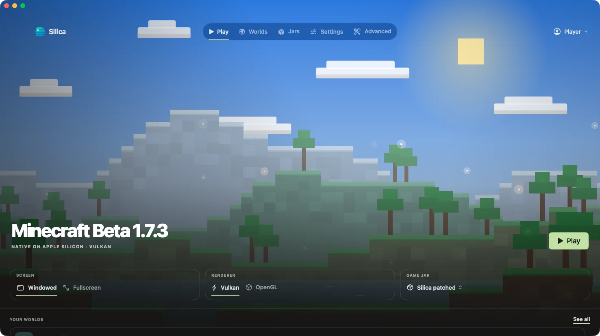

<p align="center">
  
</p>

<p align="center">
  <b>A launcher and an improved build of Minecraft Beta 1.7.3, made for the Mac.</b><br>
  Native on Apple Silicon. Vulkan renderer. No Rosetta.
</p>

<p align="center">
  <a href="https://silicalauncher.xyz"><b>silicalauncher.xyz</b></a>
  &nbsp;·&nbsp;
  <a href="docs/DEVELOPMENT.md">Developing</a>
  &nbsp;·&nbsp;
  <a href="CHANGELOG.md">Changelog</a>
  &nbsp;·&nbsp;
  <a href="https://silicalauncher.xyz/privacy">Privacy</a>
</p>

<p align="center">
  
  
  
  
  
</p>

<br>

<p align="center">
  
</p>

## What it is

Silica runs Beta 1.7.3 natively on Apple Silicon: an arm64 Java 21 runtime, LWJGL 3 with GLFW and OpenAL, and a Vulkan 1.2 renderer on MoltenVK. Worlds stay plain Beta 1.7.3 worlds, so they work with the original game and with servers. A SwiftUI launcher handles setup, sign-in, worlds and settings.

> **This repository contains no Mojang code, jars or assets.** You need to own Minecraft: Java Edition. On first run Silica downloads the game from Mojang's own servers (or uses a copy you already have), checks it against Mojang's checksum, and prepares it on your Mac. Silica's changes are applied to that copy at load time.

## Performance

Same world, camera path and seed on both renderers. Average FPS on an Apple M5, 1080p fullscreen, seed 1337.

| Render distance | OpenGL | Vulkan |
|---|---:|---:|
| Far · 256 blocks | 83 | **289** |
| Normal · 128 blocks | 160 | **374** |

On the far setting that is about 3.5× the frame rate, with a 99th percentile frame of 7.4 ms. The title screen is up in about 1.5 s, against about 3.2 s for the original game under Rosetta.

## The launcher

<table>
  <tr>
    <td width="50%"></td>
    <td width="50%"></td>
  </tr>
  <tr>
    <td align="center"><sub>Worlds: resume, back up, import and export</sub></td>
    <td align="center"><sub>Settings</sub></td>
  </tr>
</table>

- **Microsoft sign-in** with several accounts, kept in the macOS Keychain. Silica checks the purchase before it starts the game.
- **Skins and capes** for you and for other players, and **online-mode servers** through Mojang's session service.
- **Guided setup**, performance presets, a built-in benchmark, and plain-language crash hints.

## Quality of life in the game

- **Inventory:** drag to spread stacks, number keys to swap, shift-click to craft in bulk, sort buttons.
- **Worlds:** resume your last world, autosave interval, backups, a sortable world list.
- **Controls and sound:** toggle sneak, a zoom key, volume sliders, directional sound captions.
- **Commands and debug:** optional cheats with Tab completion and a much fuller F3 screen.
- **Faster chunk generation:** terrain is generated ahead of you on background threads, and it is identical to the original's.

Gameplay stays vanilla.

## Layout

| Folder | What |
|---|---|
| [`launcher/`](launcher) | The SwiftUI launcher (SwiftPM, tests included) |
| [`game/`](game) | The renderer (OpenGL and Vulkan backends), the LWJGL 2 compatibility layer, networking |
| [`platform/`](platform) | A GLFW / LWJGL 3 layer with the LWJGL 2 API the game expects |
| [`hooks/`](hooks) | Patch definitions and Silica's own implementations of its changes |
| [`agent/`](agent) | The Java agent that applies those patches as classes load |
| [`tools/mcprep/`](tools/mcprep) | Prepares your own jar on your Mac (names, access, LWJGL redirect) |
| [`website/`](website) | The website, static HTML and CSS |
| [`scripts/`](scripts) | Build, benchmark and image comparison helpers |

## Build the launcher

You need macOS on Apple Silicon with the Swift toolchain and JDK 21.

```bash
cd launcher
./build_app.sh        # builds Silica.app
swift test            # runs the launcher's tests
```

The game build, the preparation steps and the benchmark scripts are described in [`docs/DEVELOPMENT.md`](docs/DEVELOPMENT.md).

## Status

Sign-in works against Microsoft's live services. Downloads are not published yet, and the app is ad-hoc signed, not notarized, so macOS will warn on first open. Support for other Beta and Alpha versions is planned; the launcher is meant to run them all.

## License

Silica's source code is released under the [MIT License](LICENSE). That covers Silica's own code only. It does not cover Minecraft, which belongs to Mojang and Microsoft and is never included here, or the Minecraft name and artwork.

## Not affiliated

Silica is an unofficial project. It is not affiliated with Mojang or Microsoft. Minecraft is a trademark of Mojang Synergies AB.
